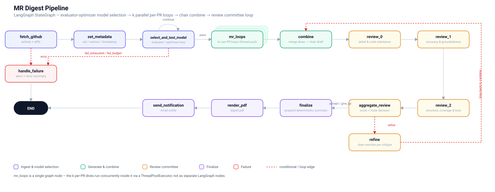

# 🤖 GitHub Digest Agent

An **autonomous, scheduled engineering report generator.** Every morning it reads
the latest commits, pull requests and **actual diffs** from your repositories,
deep-dives each of the most recent PRs with **parallel AI sub-agents**, self-reviews
and refines until it passes a quality bar, then emails you a **professional,
color-coded PDF** — stamped with a unique run ID.

<p align="center">
  <a href="docs/sample-digest.pdf">➤ <strong>View a real generated sample report (PDF)</strong></a>
</p>

## ✨ Highlights

| Capability | What it does |
|---|---|
| 🧠 **Hexagonal core** | Ports & Adapters — no vendor imports in business logic |
| ⚡ **Parallel agents** | `k` per-PR sub-agents deep-dive & self-review **concurrently** |
| 🧑‍⚖️ **Review committee** | 3 reviewers + refine loop until it meets the quality bar |
| 🔁 **Per-agent model loop** | each sub-agent picks a working free LLM at call time |
| 🔍 **Diff-aware** | reads real patches — names files, functions, PRs, actual code |
| 📄 **Color-coded PDF** | green added / red removed, cover band, page numbers |
| 🆔 **Report identity** | unique UID + version + UTC timestamp per run |
| ⏰ **Auto-scheduled** | GitHub Actions cron, 07:00 Europe/Amsterdam |

<p align="center">
  <a href="https://github.com/amagarzogonzalo/digest-agent/actions"></a>
  
  
  
  
</p>

## 🖼️ Pipeline

<p align="center">
  
</p>

The system composes two **bounded, self-improving loops** (both provably terminate):

1. **Per-MR agent loop** — each of the latest `k` merged PRs runs its own
   `deep-dive → review → refine` cycle in **parallel**, grounded in that PR's real diff.
2. **Final combine loop** — a reviewer committee (detail/accuracy/tone) scores the
   assembled digest and a `refine` step rewrites it until all reviewers pass
   (`min_quality_score`, default 8.0; up to `max_reviews=6`).

Each sub-agent **re-selects its own working model** from a free fallback chain
(Gemini → OpenRouter → Groq → Mistral), and every report is stamped with a unique
ID, version and timestamp.

---

## 🚀 Quick Start

```bash
git clone https://github.com/amagarzogonzalo/digest-agent.git
cd digest-agent
python -m venv .venv && source .venv/bin/activate   # Windows: .venv\Scripts\activate
pip install -e .[dev]

cp .env.example .env          # add your GitHub token + one LLM key + email
python -m digest_agent.main   # run once
```

With Docker:

```bash
docker build -t digest-agent .
docker run --rm --env-file .env -v "$(pwd)/digests:/data/digests" digest-agent
```

## ⚙️ Configuration

Set values in `.env` (or as environment variables). See [`.env.example`](.env.example) for the full list.

| Variable | Description |
|---|---|
| `GITHUB_TOKEN` · `GITHUB_REPOS` | Repo to read (e.g. `owner/repo`) |
| `GEMINI_API_KEY` / `OPENROUTER_API_KEY` / `GROQ_API_KEY` / `MISTRAL_API_KEY` | LLM providers (tried in order, all free) |
| `NOTIFIER` | `smtp` (Gmail/Ethereal) or `resend` |
| `RECIPIENT_EMAIL` | Where to send the digest |
| `LOOKBACK_DAYS` | Days of activity to include (default 1) |
| `REVIEW_MAX_REVIEWS` · `REVIEW_MIN_SCORE` · `PR_DEPTH` | Quality / parallelism knobs |

## 🧱 Architecture

A **Hexagonal (Ports & Adapters)** design: the application core depends only on
abstract *ports*, while concrete *adapters* (GitHub, LLM providers, ReportLab,
SMTP/Resend) are injected at the composition boundary. This keeps business logic
free of vendor SDKs and makes every stage independently testable.

```
 src/digest_agent/
 ├── ports/          # Abstract contracts (no vendor imports)
 ├── core/           # Orchestrator, state, policy, deterministic snapshot, fakes
 ├── adapters/       # Driven adapters (GitHub, Gemini/Groq/Mistral/OpenRouter,
 │                   #   ReportLab PDF, SMTP/Resend)
 └── main.py         # Composition root
```

## 🧪 Tests

```bash
python -m pytest tests/ -v
```

44 tests cover the model-selection evaluator, the parallel per-PR loops, the
review/refine committee, the deterministic snapshot, and every adapter.

## 🔍 Sample Report

See everything end-to-end: **[open a real generated digest (PDF)](docs/sample-digest.pdf)**.

---

### License

Released under the **[MIT License](LICENSE)**. You're free to use, modify, and
distribute it — just retain the copyright notice.